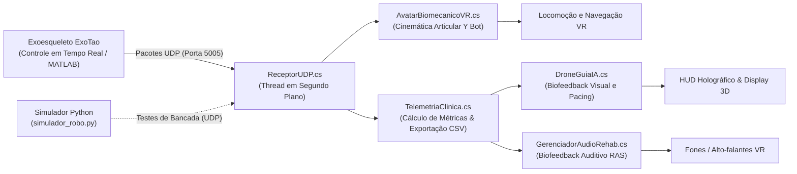

# 🦿 ExoTao VR Rehab — Plataforma de Reabilitação Virtual com Exoesqueleto Robótico

O **ExoTao VR Rehab** é um ambiente de Realidade Virtual imersivo e gamificado desenvolvido na **Unity 6 LTS**, projetado para apoiar sessões de reabilitação motora de membros inferiores em pacientes integrados ao exoesqueleto robótico **ExoTao** do Laboratório de Robótica e Reabilitação (**ReRobLab**).

A plataforma utiliza o paradigma de **Locomoção Guiada pela Marcha (Gait-Driven Locomotion)**, convertendo os dados articulares de flexão/extensão de quadril e joelho em tempo real para a cinemática de um avatar virtual 3D, com biofeedback multimodal (visual, auditivo e háptico), telemetria clínica automatizada e um assistente virtual inteligente.

---

## 🌟 Principais Recursos e Inovações

### 1. 🤖 Avatar Biomecânico 3D e Cinemática em Tempo Real
- **Mapeamento Articular Direto:** Leitura contínua dos ângulos de quadril e joelho (bilateral) recebidos via pacotes UDP/TCP da instrumentação do exoesqueleto.
- **Cinemática Suave e Compensação:** Conexão hierárquica aos ossos do modelo 3D (*Y Bot*), associando a rotação fisiológica com interpolação `Quaternion.Slerp` para eliminar transições abruptas e manter a estabilidade postural.
- **Locomoção Orgânica:** O deslocamento no cenário virtual acompanha a frequência de passada real do paciente (evitando o efeito de deslizamento/"skating" e prevenindo a cinetose em VR).

### 2. 🛸 Drone Guia Inteligente (`EXO-BOT`) com Biofeedback
- **Pacing Adaptativo de Marcha:** O mascote voa de forma autônoma à frente do paciente, ajustando sua velocidade e distância relativa para conduzir a velocidade da caminhada.
- **Biofeedback Visual de Simetria:** Monitora o índice de simetria bilateral em tempo real e sinaliza o estado clínico por meio de um sistema de código de cores:
  - 🟢 **Verde:** Meta de passos comemorada com trinado sonoro e pirueta.
  - 🔵 **Ciano:** Marcha fluida e padrão biomecânico simétrico (> 80%).
  - 🔷 **Azul:** Aguardando início do movimento pelo paciente.
  - 🟡 **Âmbar:** Alerta clínico de assimetria (< 76%), indicando qual membro requer maior flexão.
- **Modelo 3D CAD Dedicado:** Modelado no **Blender 5.1** com chassis esférico, linhas de emissão em ciano, lente óptica frontal e anéis toroidais laterais contínuos, otimizado em malha única para baixo consumo de CPU/GPU.

### 3. 🖐️ Manipulação Espacial VR do HUD (Estilo Meta Quest & SteamVR Hub)
- **Pinçar e Arrastar (Raycast Spatial Drag):** O usuário pode apontar o laser de qualquer controle VR (ou cursor do mouse) para o Drone ou seu HUD holográfico, segurar o gatilho/grip e posicioná-lo livremente em qualquer lugar do campo de visão (laterais, mais alto ou mais baixo).
- **Ajuste Dinâmico de Proximidade:** Controle de distância (mais perto / mais longe) através do scroll do mouse, analógico dos controles VR ou botões rápidos integrados na barra inferior do HUD.
- **Memória de Posição Relativa:** O drone memoriza a posição personalizada e continua acompanhando o paciente com a nova referência espacial.

### 4. 🎵 Sistema de Áudio Clínico & Estimulação Auditiva Rítmica (RAS)
- **Estimulação Auditiva Rítmica (RAS):** Geração de pulsos acústicos orgânicos e suaves sincronizados a cada contato de calcanhar (D/E), promovendo o arraste sensoriomotor e a cadência ideal.
- **Vocalizações Expressivas do Mascote:** Efeitos sonoros suaves inspirados em mascotes amigáveis (*Astro Bot*, *Wall-E*), incluindo saudações, sons comemorativos e ronronar eletrônico responsivo ao toque/pinça no VR.
- **Ambientação Confortável:** Camadas de música relaxante e paisagens sonoras naturais (riachos, brisa e pássaros) por cena, mitigando a ansiedade e reduzindo a percepção de fadiga motora.
- **Efeitos de Interface:** Feedback tátil e auditivo suave ao navegar e acionar botões e seletores.

### 5. 📊 Telemetria Clínica e Registro Científico
- **Monitoramento em Tempo Real:** Registro ininterrupto de passos totais e individuais (perna direita/esquerda), distância percorrida (m), velocidade média/instantânea (m/s), cadência (Passos por Minuto - SPM) e Índice de Simetria da Marcha (%).
- **Exportação Automatizada em CSV:** Gravação de relatórios detalhados com carimbo de data/hora a cada término ou pausa da sessão na pasta `Relatorios_Clinicos/`.
- **Analisador Biomecânico em Python:** Script integrado (`analisador_telemetria_ic.py`) para geração automática de gráficos com curvas cinemáticas, simetria e dispersão de cadência para artigos e relatórios de pesquisa.

### 6. 🗺️ Ambientes Virtuais de Reabilitação
A plataforma conta com múltiplos cenários estáticos e exploráveis selecionáveis pelo menu:
- **Menu Principal Sci-Fi:** Sala imersiva com terminal holográfico 3D apresentando o esquemático CAD do Drone, biofeedback e dados de telemetria ao vivo.
- **Floresta e Rio:** Trilha natural arborizada, ideal para caminhada prolongada e relaxamento.
- **Campos Mediterrâneos:** Paisagem ensolarada e aberta com topografia suave.
- **Casa Suíça & Pequeno Porto:** Ambientes com ambientação arquitetônica e marítima.
- **Centro Metropolitano & Escadaria Histórica:** Desafios de ambientação urbana com planos horizontais e desníveis controlados.
- **Montanhas Nevadas & Cena de Testes:** Ambientes complementares para testes de desempenho e calibração de sensores.

---

## 📐 Arquitetura de Comunicação

O fluxo de dados entre o hardware robótico e a aplicação gráfica ocorre através de sockets de baixa latência em rede local:



---

## 🛠️ Tecnologias Utilizadas

- **Engine:** Unity 6 LTS (`6000.0.85f2`)
- **Linguagem Principal:** C# (.NET / Mono)
- **Framework VR:** OpenXR & Unity XR Interaction Toolkit (`2.6.5`)
- **Modelagem 3D & Pipeline:** Blender 5.1 (CLI / Automação Python `bpy`)
- **Rede e Comunicação:** Protocolo UDP (Sockets assíncronos de alta frequência)
- **Análise de Dados:** Python 3.12 (NumPy, Matplotlib)
- **Compatibilidade de Hardware:** HTC Vive, HTC Vive Pro, Meta Quest (via Link / AirLink / SteamVR) e suporte completo a Desktop / XR Device Simulator.

---

## 🚀 Como Executar o Projeto

### Pré-requisitos
1. **Unity Hub** com a versão **Unity 6 LTS (6000.0.85f2)** ou superior instalada.
2. **Python 3.8+** (para execução do simulador ou scripts de análise estatística).
3. **SteamVR / OpenXR Runtime** (caso for executar diretamente em óculos VR).

### Execução em Modo de Simulação (Sem o Robô Físico)

O projeto inclui ferramentas completas para validação em bancada ou computadores de desenvolvimento sem necessidade do robô conectado:

1. **Clone o repositório:**
   ```bash
   git clone -b unity6-exotao-evolution https://github.com/AlexandreBZFilho/ExoTao_VR.git
   ```
2. **Abra o projeto no Unity Hub** selecionando a pasta clonada.
3. **Abra a cena principal:**
   Navegue até `Assets/Scenes/Menu_Principal.unity` e dê dois cliques.
4. **Inicie o Play Mode** na Unity.
5. **Inicie o envio de dados virtuais (duas alternativas):**
   - **Opção A (Simulador Interno da Unity):** Com o jogo em execução, pressione a tecla **`F9`** no teclado para ativar a simulação biomecânica interna de marcha humana.
   - **Opção B (Simulador Externo Python):** Abra um terminal na raiz do projeto e execute:
     ```bash
     python simulador_robo.py
     ```
6. **Controles de Teclado/Mouse no Editor:**
   - **`WASD` / Setas:** Movimentação do paciente no ambiente.
   - **`Botão Esquerdo do Mouse`:** Pinçar e arrastar o Drone Guia ou seu painel para reposicioná-lo no espaço.
   - **`Scroll do Mouse`:** Ajustar a proximidade (mais perto ou mais longe) do assistente virtual.
   - **`R`:** Resetar a posição do drone para o centro à frente do paciente.
   - **`F9`:** Alternar o simulador interno de marcha e telemetria.

---

## 📂 Estrutura dos Principais Scripts (`Assets/Scripts/`)

- [`ReceptorUDP.cs`](Assets/Scripts/ReceptorUDP.cs): Gerenciamento da conexão UDP, recepção contínua de pacotes em thread dedicada e decodificação dos ângulos das juntas articulares.
- [`AvatarBiomecanicoVR.cs`](Assets/Scripts/AvatarBiomecanicoVR.cs): Mapeamento dos ângulos recebidos para a cinemática dos ossos da perna do avatar 3D com amortecimento e alinhamento biomecânico.
- [`DroneGuiaIA.cs`](Assets/Scripts/DroneGuiaIA.cs): Máquina de estados finitos (FSM) do Drone Guia, biofeedback visual, flutuação procedural e sistema de manipulação espacial via raycast (Pinch & Drag).
- [`GerenciadorAudioRehab.cs`](Assets/Scripts/GerenciadorAudioRehab.cs): Controle central de áudio, sonificação de passos para Estimulação Auditiva Rítmica (RAS), ambiências por cena, sons táteis de UI e vocalizações de mascote do drone.
- [`TelemetriaClinica.cs`](Assets/Scripts/TelemetriaClinica.cs): Monitoramento e cálculo de cadência, índice de simetria, distância e gravação dos relatórios clínicos estruturados em CSV.
- [`EstacaoHologramaDroneMenu.cs`](Assets/Scripts/EstacaoHologramaDroneMenu.cs): Montagem procedural da estação 3D do Menu Principal, incluindo console, projetor de holograma, display wall triplo e telemetria ao vivo.
- [`Editor/PainelControleICEditor.cs`](Assets/Scripts/Editor/PainelControleICEditor.cs): Menu utilitário no Unity Editor (`ExoTao IC/`) para setup automatizado de todas as cenas, correção global de materiais e abertura rápida de ferramentas e relatórios.

---

## 🔬 Pesquisa e Desenvolvimento

Este projeto é desenvolvido no âmbito de pesquisas de Iniciação Científica e pós-graduação no **ReRobLab** (Laboratório de Robótica e Reabilitação), tendo como foco a interseção entre engenharia mecatrônica, robótica de reabilitação e ambientes virtuais imersivos aplicados à recuperação neurofuncional.
